# Track 1 Q1 Linux File System and Links - Steps

# Track 1: Linux and Networking

## Question 1: Linux File System and Links

**Part A: Files, Directories and Links**

This document lists the steps followed for each task. The screenshot for each task is stored in the repository as `t1q1a<task>.png`.


---

## Task 1: Create Playground, Cricket and Football, and display the tree

**Screenshot:** `t1q1a1.png`

### Steps

1. Go to the home directory.
2. Create `Playground` in the home directory.
3. Create `Cricket` and `Football` inside `Playground` with a single command.
4. Display the directories as a tree, starting from the home directory.


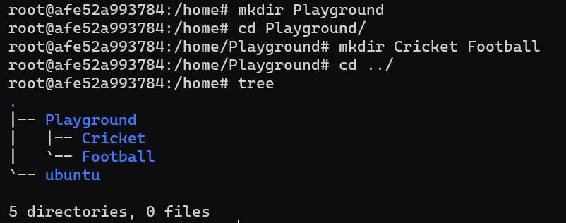

---

## Task 2: Create the player files and list both with a single command

**Screenshot:** `t1q1a2.png`

### Steps

1. Create `football_players.txt` in `home/Playground/Football`.
2. Create `cricket_players.txt` in `home/Playground/Cricket`.
3. List both files with a single command.

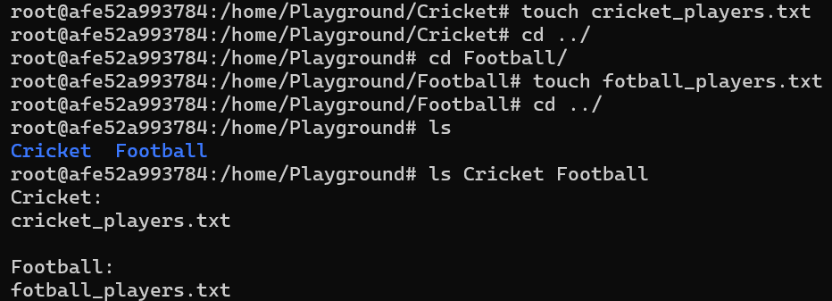

---

## Task 3: Create the Players directory, add 11 players, and print the first and last five

**Screenshot:** `t1q1a3.png`

### Steps

1. Create the `Players` directory in the home directory.
2. Create `football_players.txt` and `cricket_players.txt` inside it.
3. Open each file in a text editor and add 11 players of your choice, one per line.
4. With a single command, print the first five players from the cricket file and the last five from the football file.


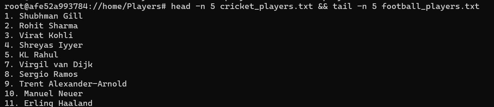

---

## Task 4: Copy files, edit the cricket file, and use an overwrite prompt

**Screenshots:** `t1q1a4-1.png` and `t1q1a4-2.png`

### Part 1: Copy the football file and print it (`t1q1a4-1.png`)

1. Copy `Players/football_players.txt` into `Playground/Football`.
2. Print the contents of the copied file.

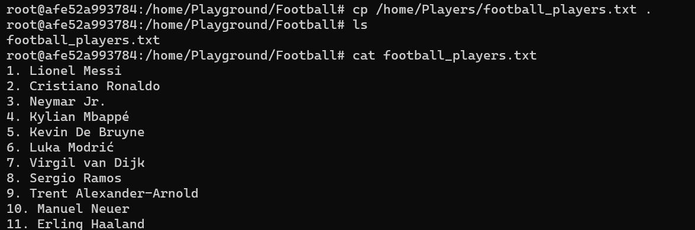

### Part 2: Edit the cricket file and copy with an overwrite prompt (`t1q1a4-2.png`)

1. Open `Playground/Cricket/cricket_players.txt` in an editor.
2. Add the line `Virat Singh Kumar Dhoni Sharma` at the top.
3. Run `cat` to confirm.
4. Copy `Players/cricket_players.txt` into `Playground/Cricket` using `-i` (interactive) so the shell prompts `Overwrite?` before replacing the file.

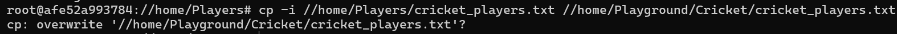

---

## Task 5: Rename Players to Done, then delete it

**Screenshot:** `t1q1a5.png`

### Steps

1. Rename `Players` to `Done` with `mv`.
2. Delete the `Done` directory and its contents with `rm -r`.
3. Run `ls` to confirm the directory is gone.

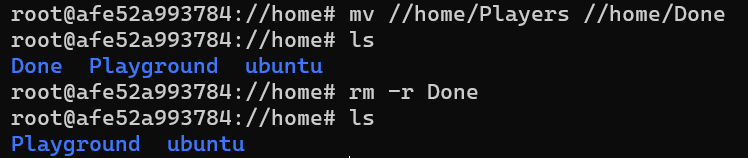

---

## Task 6: Coaches directory, hard link and soft link

### 6.a Create Coaches and list its files

**Screenshot:** `t1q1a6-a.png`

1. Create the `Coaches` directory in the home directory.
2. Create `football_manager.txt` containing `Jose Alex Guardiola`.
3. Create `cricket_coach.txt` containing `Ravi Gambhir Dravid Ganguly`.
4. List the files in `Coaches`.

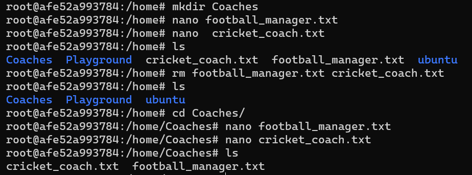

### 6.b and 6.c Create the hard link and the soft link

**Screenshot:** `t1q1a6-bc.png`

1. Create a **hard link** named `cric_coach` in `Cricket`, pointing to `cricket_coach.txt`.
2. Create a **soft (symbolic) link** named `foot-manager` in `Football`, pointing to `football_manager.txt`.

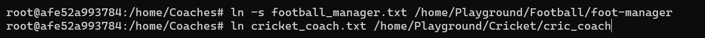

### 6.d List the contents of Cricket and Football with inode numbers

**Screenshots:** `t1q1a6-d.png` and `t1q1a6-d_.png`

1. Use `ls -li` to show the inode number (`-i`) in long format (`-l`).
2. Compare the inode numbers:
   - The hard link `cric_coach` has the **same inode** as `cricket_coach.txt`.
   - The soft link `foot-manager` has its **own inode** and points to the path of the original file.

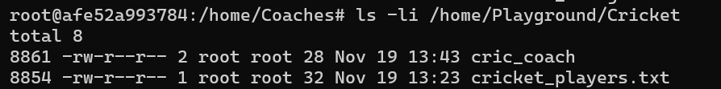

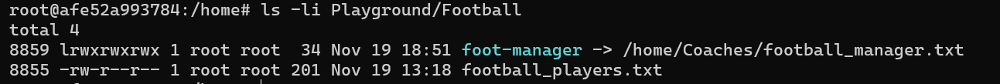

### 6.e Delete Coaches and display the links

**Screenshot:** `t1q1a6-e.png`

1. Delete the `Coaches` directory.
2. Display the contents of `cric_coach` (hard link).
3. Display the contents of `foot-manager` (soft link).

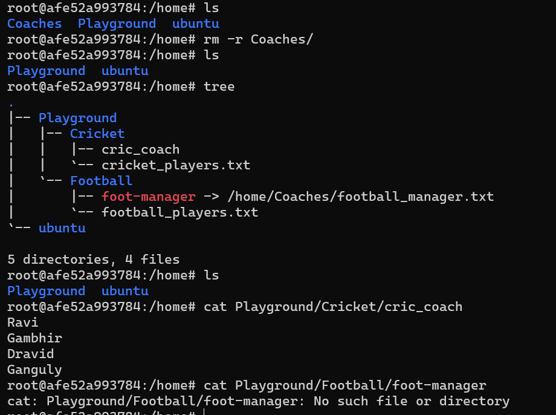

#### Explanation of the different results

| Link type | Command | Result after deleting `Coaches` | Reason |
|---|---|---|---|
| Hard link | `cat cric_coach` | Displays `Ravi Gambhir Dravid Ganguly` | A hard link is another directory entry that points to the same inode (the actual data). Deleting the original name only removes one reference. The data stays on disk until the link count drops to 0. |
| Soft link | `cat foot-manager` | Error: `No such file or directory` | A soft link is a separate file that stores the path to the original file. Once the original file is deleted, the path points to nothing, so the link is **dangling (broken)**. |

---

## Summary of Screenshots

| Task | Description | Screenshot |
|---|---|---|
| 1 | Create directories and display the tree | `t1q1a1.png` |
| 2 | Create files and list them | `t1q1a2.png` |
| 3 | Players directory, `head` and `tail` | `t1q1a3.png` |
| 4 | Copy and print the football file | `t1q1a4-1.png` |
| 4 | Edit the cricket file and `cp -i` prompt | `t1q1a4-2.png` |
| 5 | Rename and delete `Players` / `Done` | `t1q1a5.png` |
| 6.a | Create Coaches files and list them | `t1q1a6-a.png` |
| 6.b, 6.c | Hard link and soft link | `t1q1a6-bc.png` |
| 6.d | Inode listing | `t1q1a6-d.png`, `t1q1a6-d_.png` |
| 6.e | Delete Coaches and compare links | `t1q1a6-e.png` |

---

# Part B: Users, Groups and Permissions

**Environment:** Ubuntu 26.04 Docker container, running as `root`.
**Scenario:** HashedIn's confidential *Project HU* involves three employees: Sid, Harsh and Kanth.


---

## Task 1: Create three users with home directories

**Screenshot:** `t1q1b1.png, t1q1b1_.png`

- `-m` creates the home directory `/home/<user>` automatically.
- `-s /bin/bash` sets Bash as the login shell.
- `ls /home` and `id` confirm the users, their home directories and their private groups.

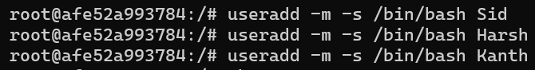
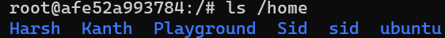

---

## Task 2: Create the groups `devops` and `SRE`

- `getent group` shows both groups with their GIDs and no members yet.

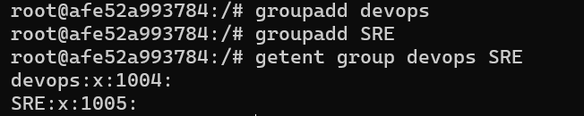

---

## Task 3: Add Harsh to `devops` and Kanth to `SRE`

- `-a` appends the group and `-G` names the supplementary group.
- Without `-a`, `-G` would replace all of the user's existing supplementary groups.

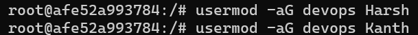

---

## Task 4: Add Sid to `devops` and give him sudo access

- On Ubuntu, members of the `sudo` group get administrator rights through the rule `%sudo ALL=(ALL:ALL) ALL` in `/etc/sudoers`.
- `sudo -l -U Sid` lists what Sid is allowed to run, which confirms the access.

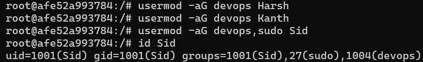

---

## Task 5: Create `/Project-HU` owned by `devops` with numeric permissions

| Digit | Applies to | Permission |
|:-----:|-----------|------------|
| 7 | Owner (`root`) | `rwx` |
| 7 | Group (`devops`) | `rwx` (read, write, execute) |
| 0 | Others | `---` (no access) |

- `chgrp devops` makes `devops` the owning group.
- `chmod 770` gives the group full access and others none.
- Expected result: `drwxrwx--- 2 root devops ... /Project-HU`.

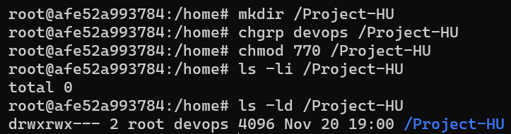

---

## Task 6: Create `deploy.sh` and set execute permission

- The script prints `Project is Live`.
- `chmod 770` sets the execute permission in numeric mode.
- `chgrp devops` is needed because root created the file, so its group defaults to `root`.
- Expected result: `-rwxrwx--- 1 root devops ... deploy.sh`, followed by the output `Project is Live`.

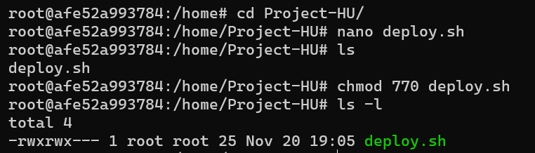

---

## Task 7: Show Harsh's `/etc/passwd` entry and explain each field

Output:

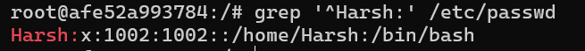

| # | Field | Value | Explanation |
|:-:|-------|-------|-------------|
| 1 | Username | `Harsh` | The login name. It is case-sensitive, so `Harsh` and `harsh` are different users. |
| 2 | Password | `x` | The password is not stored here. The `x` means the hash is in `/etc/shadow`, which only root can read. |
| 3 | UID | `1002` | The numeric user ID. Regular users start at 1000. |
| 4 | GID | `1002` | The primary group ID. It is Harsh's own private group, also named `Harsh`. |
| 5 | GECOS | *(empty)* | An optional comment field for full name, phone and so on. It is blank because it was not set with `useradd`. |
| 6 | Home directory | `/home/Harsh` | The directory Harsh starts in after login. `-m` created it. |
| 7 | Login shell | `/bin/bash` | The program that runs at login. |


---

## Task 8: Force Kanth to change his password at next login

- `-d 0` sets the "last password change" date to day 0 (1 Jan 1970), so the password counts as expired.
- Kanth must set a new password at his next login.
- `chage -l` shows `Last password change : password must be changed`.
- `passwd -e Kanth` gives the same result.

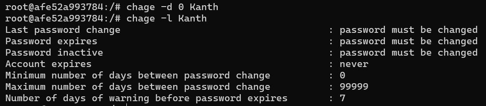

---

## Task 9: Set a 7-day password-expiry warning for Harsh

- `-W 7` warns Harsh 7 days before his password expires.
- `chage -l` shows `Number of days of warning before password expires : 7`.
- The warning only appears once a maximum password age is set. The default is 99999 days.

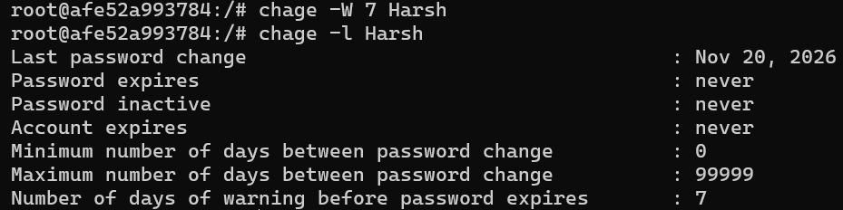

---

## Task 10: Remove Harsh's access to `/Project-HU`

- Before: Harsh is in `devops`, so he can list `/Project-HU` and sees `deploy.sh`.
- `gpasswd -d Harsh devops` removes him from the group.
- After: he falls under "others", which has `---` permissions, so the listing fails with `Permission denied`.
- `deluser Harsh devops` does the same thing.
- Harsh's account still exists. Only his group-based access is gone.

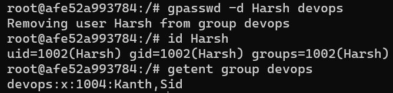

---

## Task 11: Delete group `SRE` and user `Kanth`, then check `/home`

- `getent group SRE` returns nothing, so the group is gone.
- `id Kanth` returns `no such user`.

**Was Kanth's home directory removed? No.** `/home/Kanth` is still listed.

**Why:**
- `userdel` without `-r` only deletes the account records from `/etc/passwd`, `/etc/shadow` and `/etc/group`. It also removes his private group `Kanth`.
- It leaves the home directory and mail spool in place on purpose, so files are not lost by accident.
- The directory is now orphaned. Its owner UID no longer maps to a username, so `ls -ln` shows a bare number.
- To delete the home directory, use `userdel -r Kanth`, or run `rm -rf /home/Kanth` afterwards.
- `groupdel SRE` worked because SRE was only Kanth's supplementary group. `groupdel` refuses to remove a group that is some user's primary group.

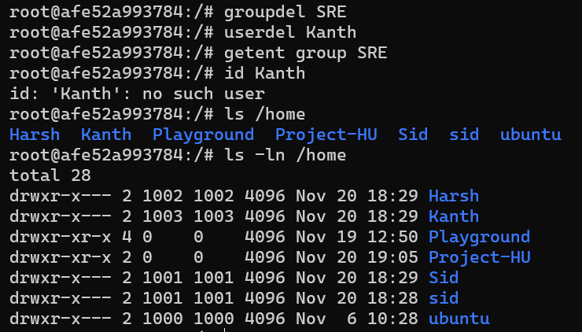

# Question 2: Text Processing and Data Analytics

**Source file:** [employees.txt](https://github.com/mkuthan/example-spark/blob/master/src/main/resources/data/employees.txt) (client employee data on GitHub)

**File layout:** comma-separated, no header row, 12 records.

| Field 1 | Field 2 | Field 3 | Field 4 (last) |
|:-------:|:-------:|:-------:|:--------------:|
| ID | First name | Last name | Age |

---

## Task 1: Download the file as plain text

- I used the **raw** URL (`raw.githubusercontent.com`). The normal `github.com/.../blob/...` link returns an HTML page, not plain text.
- `-o employee.txt` saves the download under that name in the home directory (`~`).
- The raw URL serves the file directly with no redirect, so `-L` (follow redirects) is not needed.
- `file employee.txt` reports `ASCII text`, which confirms the file is plain text and not HTML.
- `head -3` previews the first 3 lines to confirm the comma-separated layout.

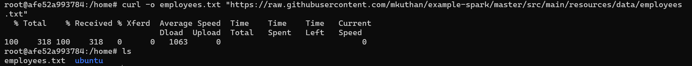

---

## Task 2: Display the first 3 lines and the last line with one command


- `1,3p` prints lines 1 to 3 and `$p` prints the last line.
- `-n` stops `sed` from also printing every line by default.
- Using `head` and `tail` together would take two commands, so `sed` is used to meet the "one command" requirement.

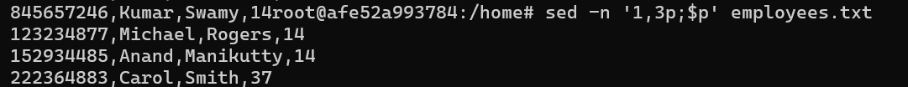

---

## Task 3: Find employees with last name Doe or Smith

- `-E` enables extended regex, so `|` works as OR.
- The commas on both sides make the pattern match the **whole last-name field**. `Goldsmith` is not matched, and neither is a first name equal to "Doe" or "Smith".
- `>` writes the matches to the file `DoeandSmiths`.
- Result: 4 employees (Carol Smith, John Doe, David Smith, Elizabeth Doe).

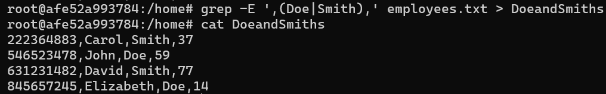

---

## Task 4: Sort by age (descending) and count the employees

- `-t','` sets the comma as the field delimiter.
- `-k4` sorts on field 4, which is the age.
- `-n` sorts numerically, so 9 sorts below 45.
- `-r` reverses the order to give descending.
- `>` saves the result to `sorted_employees.txt` without printing it to the screen.
- `cat` then displays the file, and `wc -l <` prints the line count, which is the number of employees.
- Result: **12** employees.

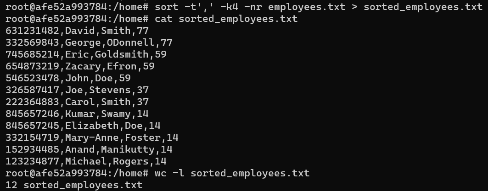

---

## Task 5: Find the employee with the highest age

- The pipe `sort ... | head -1` sorts by age in descending order and keeps only the first line.
- `head -1` stops reading once it has the first line, so no loop or extra variable is needed.
- **There is a tie.** Two employees share the highest age, 77:
  - `332569843,George,ODonnell,77`
  - `631231482,David,Smith,77`
- The `head -1` command shows only one of them. The `awk` command prints every employee at the maximum age.

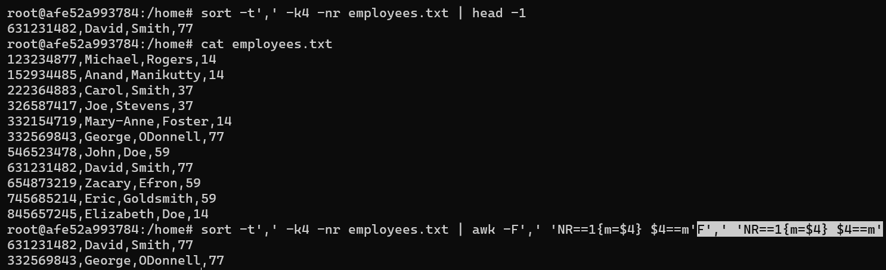

---

## Task 6: Print the first name (column 2) and the age (last column)

- `-d ','` sets the comma as the delimiter.
- `-f 2,4` selects field 2 (first name) and field 4 (age, the last column).
- Output looks like `Michael,14`.

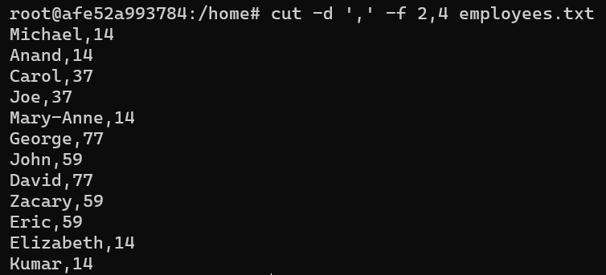

---

## Task 7: Print the 3rd and 5th lines, then delete every line containing Doe

- `sed -n '3p;5p'` prints only lines 3 and 5:
  - `222364883,Carol,Smith,37`
  - `332154719,Mary-Anne,Foster,14`
- `sed '/Doe/d'` deletes every line containing `Doe` in place.
- `grep -c 'Doe'` prints `0`, which confirms no Doe lines remain.
- `wc -l` prints `10`. The two Doe records (John and Elizabeth) were removed from the original 12.

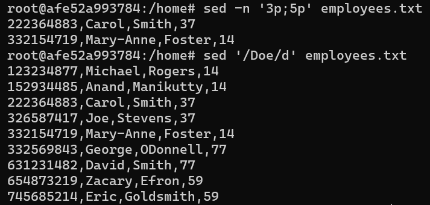

---

# Question 3: Processes, Signals and Disks

**Environment:** Ubuntu Docker container (`afe52a993784`) running on Docker Desktop for Windows, logged in as `root`.

**Terminals used:** The container's original shell (PID 1, `pts/0`) was left untouched. Two extra shells were opened with `docker exec -it`:

| Terminal | Role |
|----------|------|
| **Terminal A** (`pts/2`) | Ran all job-control commands (`&`, `jobs`, `fg`, `bg`, `wait`) and kept the variables `$P1`, `$S1` and so on. All screenshots come from here, unless noted. |
| **Terminal B** (`pts/3`) | Only used to send `kill -TSTP <PID>`, in place of Ctrl+Z. |

> **Why not Ctrl+Z?** Pressing Ctrl+Z in this Windows and Docker setup ended the container's terminal session and stopped the container. `SIGTSTP` is the signal Ctrl+Z sends, so I sent it with `kill -TSTP` from a second terminal. The effect is the same: the foreground job is suspended.

> **Prerequisite (no screenshot):** the minimal image had no `ps` or `pgrep`, so I installed `procps` first.
>
> ```bash
> apt-get install procps
> ```

---

## Task 1: List all running processes

- `ps aux` lists every process from all users, with PID, CPU and memory use, terminal (TTY), state (STAT), start time and command.
- In a container the list is short. PID 1 is the container's main `bash` shell, not `systemd`.
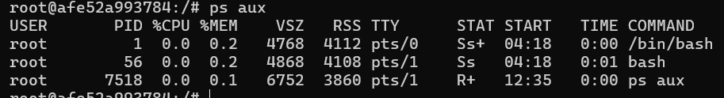

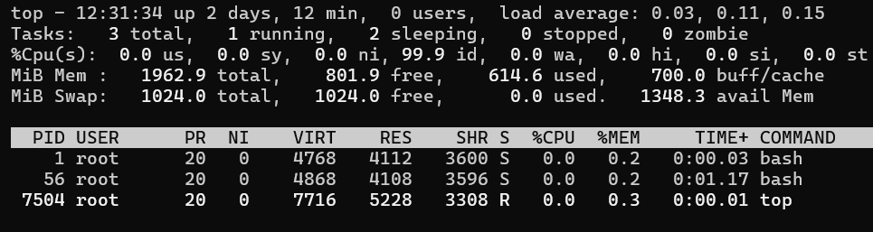

---

## Task 2: List foreground and background jobs

```bash
# Terminal A
sleep 3000 &          # background job
sleep 4000            # foreground job (terminal is now blocked)

# Terminal B: suspend the foreground job (same signal as Ctrl+Z)
kill -TSTP $(pgrep -f '[s]leep 4000')

# Terminal A
jobs -l
ps -o pid,stat,tty,cmd
```

- `&` starts `sleep 3000` in the **background**, so the prompt stays free.
- `sleep 4000` runs in the **foreground** and blocks the terminal, so `jobs` can't be typed until it is suspended.
- `kill -TSTP` from Terminal B suspends the foreground job, and Terminal A shows `[2]+ Stopped sleep 4000`.
- `jobs -l` then lists both jobs with their PIDs:
  - `[1]` is `Running` (background).
  - `[2]+` is `Stopped` (the suspended foreground job).
- `ps` shows the state of each job in the STAT column:

| STAT | Meaning |
|:----:|---------|
| `S` | Sleeping (waiting for its timer). The background job shows this, with no `+`. |
| `S+` | Sleeping in the **foreground** process group. The `+` marks the foreground. |
| `T` | **Stopped** (suspended by `SIGTSTP`). |
| `Ss` | Session leader (the shell). |
| `R+` | Running in the foreground (`ps` itself). |

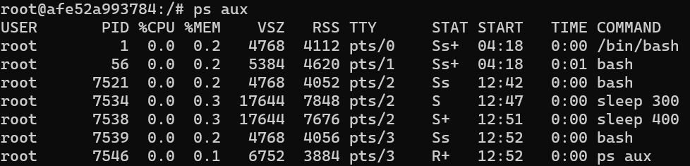

---

## Task 3: Background, foreground, background again, kill, confirm

```bash
# Terminal A
sleep 3000 &                 # 1. start in the background
BGPID=$!
jobs -l
fg %1                        # 2. bring it to the foreground (terminal blocks)

# Terminal B
kill -TSTP $(pgrep -x sleep) # 3. suspend it (same as Ctrl+Z)

# Terminal A
bg %1                        # 4. send it back to the background
jobs -l
kill %1                      # 5. kill it (SIGTERM)
jobs                         #    shows "Terminated"
ps -p $BGPID                 # 6. confirm it has stopped
```

| Step | Command | Effect |
|------|---------|--------|
| 1 | `sleep 3000 &` | Starts the process in the background. `$!` holds its PID. |
| 2 | `fg %1` | Brings job 1 to the foreground, and the terminal is blocked. |
| 3 | `kill -TSTP <PID>` | Suspends the job. It shows `Stopped`. |
| 4 | `bg %1` | Resumes the stopped job in the background, and `jobs -l` shows `Running`. |
| 5 | `kill %1` | Sends SIGTERM to the job, and `jobs` reports `Terminated`. |
| 6 | `ps -p $BGPID` | Prints only the header line, which confirms the process no longer exists. |

**Screenshot 3a:** start in the background, bring to the foreground, then suspend.

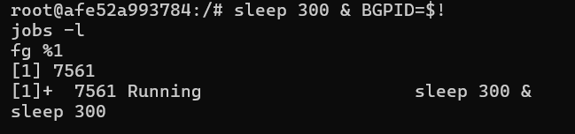

**Screenshot 3b:** send to the background, kill, confirm.

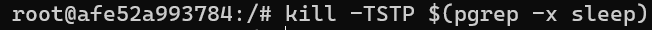

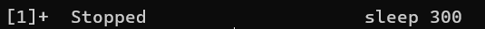
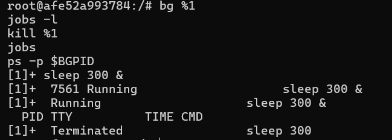

---

## Task 4: Start a sleep process, find its PID, lower its priority

- `pgrep -a sleep` finds the PID by name. `$!` holds the PID of the last background process.
- **Nice value (NI)** ranges from -20 (highest priority) to 19 (lowest). The default is 0.
- **Lowering the priority means raising the nice value.** `renice -n 10` changes NI from 0 to 10.
- `renice` prints `old priority 0, new priority 10`, and the second `ps` confirms NI = 10.
- The STAT column changes from `S` to `SN` after `renice`. The `N` flag marks a low-priority process.
- The process is killed at the end so that it does not interfere with Task 10.

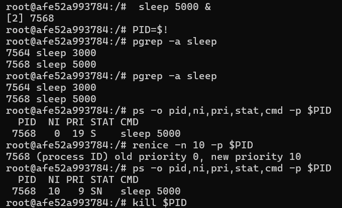

---

## Task 5: List the attached disks and identify the OS disk

- `lsblk` lists the block devices with their type, size and mount points.
- A container shares its host's kernel, so `lsblk` shows the disks of the machine or VM that Docker runs on, not private disks.
- `findmnt -o SOURCE,TARGET /etc/hosts` shows `/dev/sda1[/docker/containers/<container-id>/hosts]`. The container's files are stored on `/dev/sda1`, so `sda` is the **OS disk**.
- `df -hT /` shows the container's root filesystem as `shiftfs` (468G, 1.3G used, 443G available). This is the container's filesystem layer, and it sits on the same disk.
- `lsblk` printed `/proc/swaps: parse error at line 1 -- ignored`. This is harmless: `/proc/swaps` in the container has an empty first line, and `lsblk` ignores it.
- `cat /proc/swaps` lists no entries, so no swap is configured.

| Device | Type | Size | Mount points | Role |
|--------|------|------|--------------|------|
| `sda` (`sda1`) | disk (partition) | 475.7G | `/etc/hosts`, `/etc/hostname`, `/etc/resolv.conf` | **OS disk.** It backs the container's filesystem. |
| `sr0` | rom | 693.6M | none | Virtual CD/DVD drive. It is read-only and is not a data disk. |
| none | n/a | n/a | n/a | **No additional data disks** are attached. |

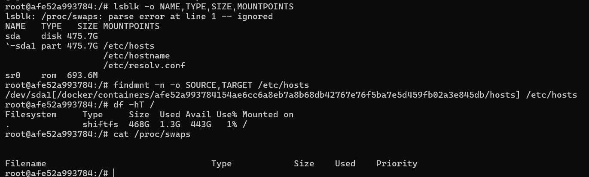

---

## Task 6: Check disk space and find the 3 largest items under /home

- `df -h` shows the size, used and available space of each filesystem in human-readable units.
- `du -ah /home` reports the size of every file and directory under `/home`.
  - `-a` includes files, not just directories.
  - `-h` prints human-readable sizes.
  - `2>/dev/null` hides permission errors.
- `sort -rh` sorts from largest to smallest and understands units such as K, M and G.
- `head -4` keeps four lines. **The first line is `/home` itself**, so the 3 largest items are lines 2 to 4.

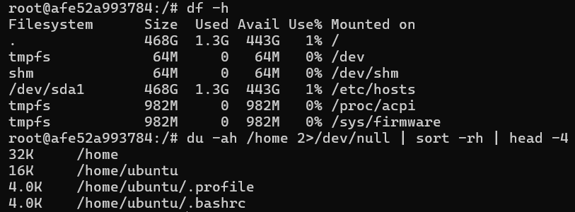

---

## Task 7: Create a 10 MB dummy file and confirm its size

- `if=/dev/zero` is an endless source of zero bytes.
- `bs=1M count=10` writes 10 blocks of 1 MiB, which is 10 MiB in total.
- Confirmation:
  - `ls -lh` shows `10M`.
  - `stat` shows exactly `10485760 bytes`, which is 10 x 1024 x 1024.
  - `du -h` shows `10M` of disk used.
- The file is created in `/root`, not `/home`, so it doesn't change the Task 6 results.

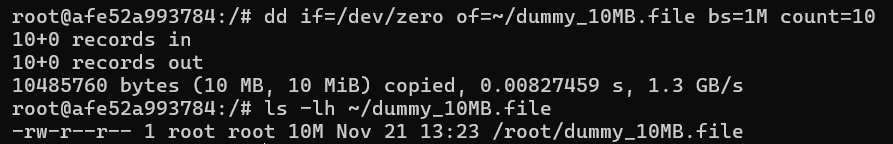

---

## Task 8: Two processes, SIGTERM to the first, SIGKILL to the second

- Both processes start in the background, and their PIDs are saved in `P1` and `P2`.
- **SIGTERM (15)** asks the process to terminate. It can be caught, so a process may clean up first. `sleep` has no handler, so it exits through the default action, with no force.
- **SIGKILL (9)** cannot be caught, blocked or ignored. The kernel removes the process immediately.
- `wait` collects each process's exit status into `S1` and `S2`. It also reaps the process, so no zombie is left behind.
- The shell reports `Terminated` for process 1 and `Killed` for process 2.
- Both `ps -p` commands print only the header line, so both processes are gone.

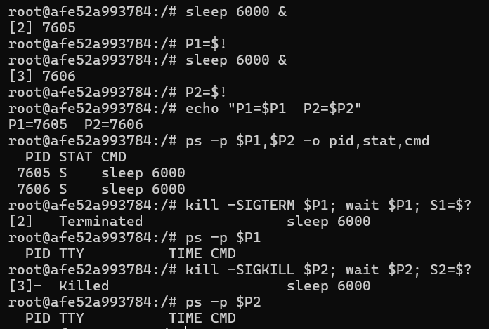

---

## Task 9: Exit status of each process

| Process | Signal | Exit status | Meaning |
|---------|--------|:-----------:|---------|
| Process 1 | SIGTERM (15) | **143** | 128 + 15, terminated by a signal. `kill -l 143` prints `TERM`. |
| Process 2 | SIGKILL (9) | **137** | 128 + 9, killed by a signal. `kill -l 137` prints `KILL`. |
| `true` | none | **0** | Normal exit, success |
| `false` | none | **1** | Normal exit, with an error code |

**How to read the status**
- **0 to 127:** the process ended on its own, by finishing or calling `exit(n)`. `0` means success and any other value is an application error code.
- **128 + N:** the process did not exit on its own. The kernel ended it with signal number `N`.
  - **143** is 128 + 15, so SIGTERM ended it.
  - **137** is 128 + 9, so SIGKILL ended it.
- A process that catches SIGTERM, cleans up and calls `exit(0)` would show status `0`. Plain `sleep` has no handler, so it shows 143.

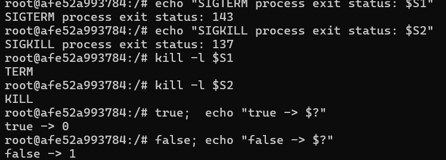

---

## Task 10: Confirm both processes are no longer running

- `ps -p $P1,$P2` prints only the column headers, so neither PID exists.
- `pgrep -a sleep` prints nothing, so the `echo` message runs. The `[s]leep` pattern in `grep` stops grep matching itself.

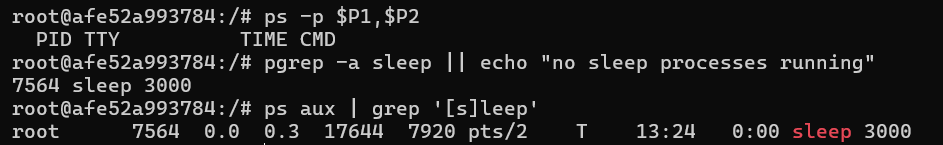

---

# Question 4: DNS Resolution and Local Name Resolution

**Environment:** Ubuntu Docker container (`afe52a993784`) on Docker Desktop for Windows, logged in as `root`.

---

## Part A: Tracing DNS

### How DNS resolution works

`dig +trace` does what a recursive resolver does, one hop at a time. It starts at a root server and follows the referrals down to the server that owns the domain.

| Stage | Who answers | What it returns |
|:-----:|-------------|-----------------|
| 1. Root | One of the 13 root servers, `a.root-servers.net` to `m.root-servers.net` | The name servers for the TLD (`com.`) |
| 2. TLD | The `.com` servers, `a.gtld-servers.net` to `m.gtld-servers.net` | The name servers for the domain. This is a referral. |
| 3. Authoritative | The domain's own name servers | The final answer, such as an `A` record. These servers hold the real data. |

### How to read the output

```
hashedin.com.   60   IN   A   35.154.73.246
^ name          ^TTL ^class ^type ^data
;; Received 215 bytes from 205.251.193.39#53(ns-295.awsdns-36.com) in 235 ms
```

- Each record has five fields: **name, TTL (seconds a cache may keep it), class (`IN` = Internet), record type, data**.
- `NS` records name the servers to ask next. `A` is an IPv4 address, `AAAA` is IPv6, and `CNAME` is an alias.
- The `;; Received N bytes from <IP>#53(<name>) in <ms>` line comes **after** each block. It names the **server that gave that block**, and shows how many bytes it sent and how long it took.
- Blocks appear in order:
  1. Root `NS` list.
  2. `com.` `NS` list.
  3. The domain's `NS` list.
  4. The final record.
- `+nodnssec` hides the DNSSEC lines (`RRSIG`, `DS`), which keeps the output short.
- `dig +trace` picks a **random** server from each `NS` list, so the answering server changes from run to run.

### Command flags used

| Flag | Purpose |
|------|---------|
| `+trace` | Walk the hierarchy from the root down. |
| `+nodnssec` | Hide the DNSSEC records. |
| `+noedns` `+nocookie` | Send plain DNS queries. They fixed the empty replies in my network (see the notes below). |
| `@a.root-servers.net` | Start the trace at a root server instead of the container's resolver. |

### Troubleshooting notes (Docker Desktop)

- A plain `dig +trace hashedin.com` printed one line, `;; Received 17 bytes from 192.168.65.7#53(192.168.65.7)`, and stopped. `192.168.65.7` is Docker Desktop's DNS forwarder. It returned no root server list, so `dig` had nothing to follow. I started the trace at a root server with `@a.root-servers.net`.
- Some authoritative servers returned an empty 30-byte reply (`;; expected opt record in response`) at the last hop. Because `dig +trace` picks the last server at random, I reran the command until a server answered.
- The first `deloitte.com` attempt timed out when asking the root servers (`;; no servers could be reached`). The same command worked on the rerun, so I treated it as a temporary network issue.

---

### Domain 1: hashedin.com

```bash
dig +trace +nodnssec +noedns +nocookie hashedin.com @a.root-servers.net
```

| Stage | Records seen | Answered by |
|-------|--------------|-------------|
| Root | `.` NS `a.root-servers.net` ... `m.root-servers.net` (TTL 518400) | `a.root-servers.net` (198.41.0.4), 112 ms |
| TLD | `com.` NS `a.gtld-servers.net` ... `m.gtld-servers.net` (TTL 172800) | `c.root-servers.net` (192.33.4.12), 378 ms |
| Authoritative | `hashedin.com.` NS `ns-62.awsdns-07.com`, `ns-608.awsdns-12.net`, `ns-710.awsdns-24.net`, `ns-295.awsdns-36.com`, `ns-1822.awsdns-35.co.uk`, `ns-1850.awsdns-39.co.uk`, `ns-1257.awsdns-29.org`, `ns-1370.awsdns-43.org` (TTL 172800) | `i.gtld-servers.net` (192.43.172.30), 299 ms |
| Final answer | `hashedin.com.` A `35.154.73.246`, `3.6.48.127`, `13.126.14.221` (TTL 60) | `ns-295.awsdns-36.com` (205.251.193.39), 235 ms |

- The root and `com.` records have long TTLs (6 days and 2 days) because they rarely change.
- The `awsdns` names show that `hashedin.com` is hosted on AWS Route 53. Its name servers are spread over `.com`, `.net`, `.org` and `.co.uk` for resilience.
- The A records have a **TTL of 60 seconds**, so changes reach resolvers within about a minute.
- Three A records give round-robin load distribution.
- The NS lines after the A records are the authoritative server repeating its own name server list.

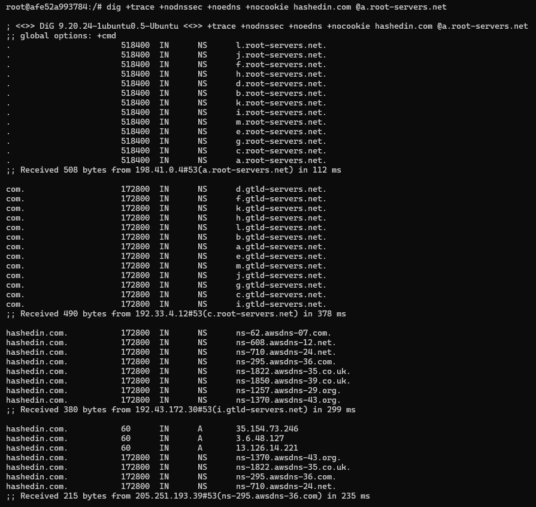

---

### Domain 2: deloitte.com

```bash
dig +trace +nodnssec +noedns +nocookie deloitte.com @a.root-servers.net
```

| Stage | Records seen | Answered by |
|-------|--------------|-------------|
| Root | `.` NS `a.root-servers.net` ... `m.root-servers.net` (TTL 518400) | `a.root-servers.net` (198.41.0.4), 106 ms |
| TLD | `com.` NS `a.gtld-servers.net` ... `m.gtld-servers.net` (TTL 172800) | `k.root-servers.net` (193.0.14.129), 78 ms |
| Authoritative | `deloitte.com.` NS `dbru.br.ns.els-gms.att.net`, `dmtu.mt.ns.els-gms.att.net`, `auth111.ns.uu.net`, `auth120.ns.uu.net` (TTL 172800) | `i.gtld-servers.net` (192.43.172.30), 281 ms |
| Final answer | `deloitte.com.` A `170.194.135.123` (TTL 3600) | `auth111.ns.uu.net` (198.6.1.115), 289 ms |

- The root and `.com` stages are the same as for `hashedin.com`. Only the delegation and the final answer differ.
- The name servers belong to `att.net` and `uu.net`, so `deloitte.com` uses a different DNS host from `hashedin.com`, not AWS Route 53.
- There is one A record with a **TTL of 3600 seconds** (1 hour), so resolvers cache it much longer than the 60-second `hashedin.com` records.
- The final reply is only 46 bytes, because it contains just the A record.

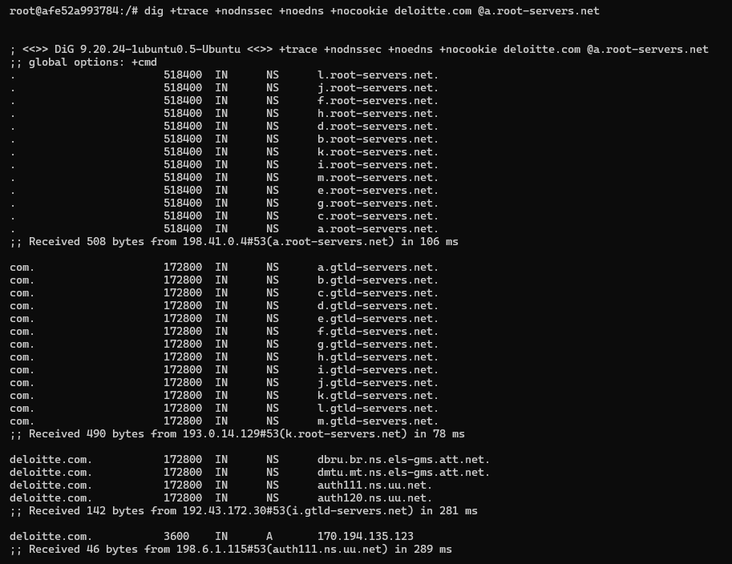

---

### Domain 3: dna.hashedin.com

```bash
dig +trace +nodnssec +noedns +nocookie dna.hashedin.com @a.root-servers.net
```

| Stage | Records seen | Answered by |
|-------|--------------|-------------|
| Root | `.` NS `a.root-servers.net` ... `m.root-servers.net` | `<fill in>` |
| TLD | `com.` NS `a.gtld-servers.net` ... `m.gtld-servers.net` | `<fill in>` |
| Authoritative | `hashedin.com.` NS `<fill in>` | `<fill in>` |
| Final answer | `dna.hashedin.com.` `<fill in: A or CNAME, with the IP or target>` (TTL `<fill in>`) | `<fill in>` |

- `dna` is a subdomain of `hashedin.com`, so the root and `.com` stages are the same as for the first domain.
- `<fill in: say whether the hashedin.com servers answered directly, or whether the trace had an extra delegation hop, or whether the answer was a CNAME and where it pointed>`

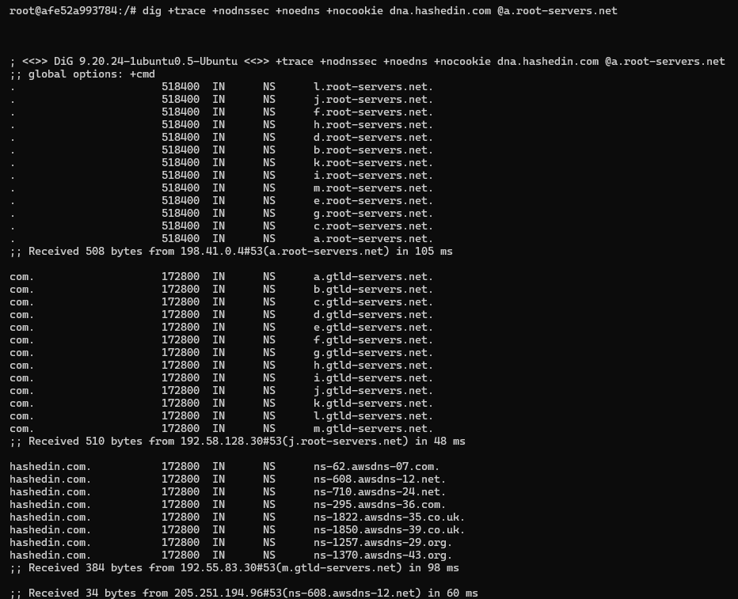

---

## Part B: Local Resolution (Ubuntu)

> **Docker note:** `/etc/hosts` and `/etc/resolv.conf` are files that Docker mounts into the container. I edited them in place with `echo >>` and `cat >`, because `sed -i` fails on them with "Device or resource busy". Docker regenerates both files when the container restarts.

### Lookup order and backups

```bash
grep '^hosts' /etc/nsswitch.conf
cp /etc/hosts /tmp/hosts.orig
cp /etc/resolv.conf /tmp/resolv.conf.orig
cat /etc/resolv.conf
```

- `hosts: files dns` means `/etc/hosts` is checked **first**, then DNS.
- The two `cp` commands keep a backup of both original files for the restore steps.
- The original resolver was `nameserver <fill in, probably 192.168.65.7>`, which is Docker Desktop's DNS forwarder.

---

### Tasks 1 and 2: Add `mypc.test` to the hosts file and verify

```bash
echo "127.0.0.1 mypc.test" >> /etc/hosts
tail -3 /etc/hosts
getent hosts mypc.test
ping -c 2 mypc.test
dig mypc.test | grep status
```

| Command | Result |
|---------|--------|
| `tail -3 /etc/hosts` | The last line is `127.0.0.1 mypc.test`. |
| `getent hosts mypc.test` | `127.0.0.1       mypc.test` |
| `ping -c 2 mypc.test` | `PING mypc.test (127.0.0.1)`, followed by replies from `127.0.0.1`. |
| `dig mypc.test \| grep status` | `status: NXDOMAIN` |

- `127.0.0.1` is the loopback address. `.test` is a reserved top-level domain (RFC 6761) that never exists in public DNS.
- `getent` and `ping` use the normal lookup order, so they find the hosts-file entry first.
- `dig` **ignores `/etc/hosts`** and asks DNS directly, so it reports `NXDOMAIN`. The hosts file is a local override, and DNS tools bypass it.


---

### Task 3: Comment out the entry and test again

```bash
sed '/mypc.test/ s/^/#/' /etc/hosts > /tmp/hosts.new
cat /tmp/hosts.new > /etc/hosts
tail -3 /etc/hosts
getent hosts mypc.test; echo "getent exit code: $?"
ping -c 2 mypc.test
```

**Observed output**

```
ff02::2 ip6-allrouters
172.17.0.2      afe52a993784
#127.0.0.1 mypc.test
getent exit code: 2
ping: mypc.test: Name or service not known
```

- The `sed` command writes a copy of the file with `#` added to the start of the `mypc.test` line, and `cat >` writes it back in place.
- `getent` prints nothing and exits with code `2`, which means "key not found".
- `ping` fails with `Name or service not known`, so it never sent a packet.
- **Reason:** the commented-out line is ignored, so the resolver falls through from `files` to `dns`. Public DNS has no `.test` domain, so the lookup fails.

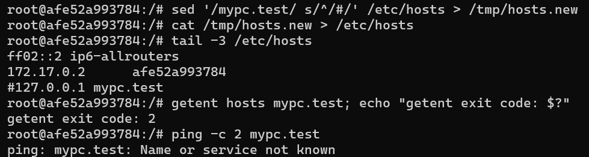

I then restored the original hosts file:

```bash
cat /tmp/hosts.orig > /etc/hosts
```
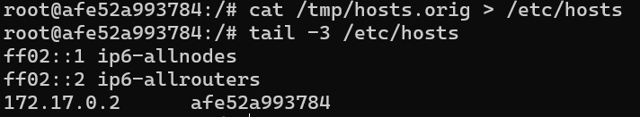
---

### Task 4: Change the DNS resolver to a dummy IP, then restore

```bash
echo "nameserver 8.8.8.1" > /etc/resolv.conf
cat /etc/resolv.conf
ping -c 2 hashedin.com
dig hashedin.com
curl -m 15 hashedin.com
ping -c 2 8.8.8.8
```

**Observed output**

| Command | Result |
|---------|--------|
| `cat /etc/resolv.conf` | `nameserver 8.8.8.1` |
| `ping -c 2 hashedin.com` | `ping: hashedin.com: Temporary failure in name resolution` |
| `dig hashedin.com` | `;; communications error to 8.8.8.1#53: timed out` three times, then `;; no servers could be reached` |
| `curl -m 15 hashedin.com` | `curl: (6) Could not resolve host: hashedin.com` |
| `ping -c 2 8.8.8.8` | 2 packets sent, 2 received, 0% loss, about 50 ms |

- `/etc/resolv.conf` tells the system which DNS server to ask. I pointed it at `8.8.8.1`, which is not a working DNS server.
- Every lookup **by name** failed after a delay, because the resolver retried and timed out with no reply.
- `ping 8.8.8.8` **by IP address still worked**. The network is fine, and only **name resolution** is broken.
- DNS is a separate step that happens before any connection. Without a working resolver, the application never learns the IP address, so the connection is never attempted.
- My earlier `dig +trace ... @a.root-servers.net` commands didn't need `/etc/resolv.conf`, because I named the root server myself.

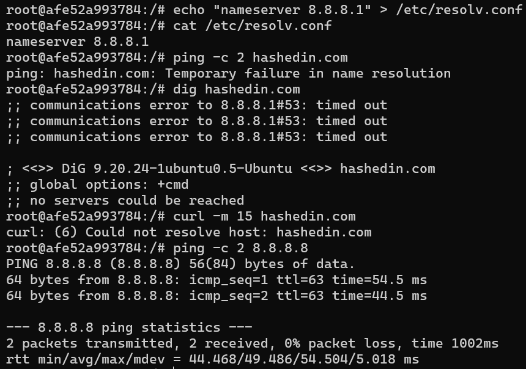

**Restore the original settings and verify**

```bash

cat /tmp/resolv.conf.orig > /etc/resolv.conf
cat /etc/resolv.conf
ping -c 2 hashedin.com
diff /tmp/resolv.conf.orig /etc/resolv.conf && echo "resolv.conf restored"
diff /tmp/hosts.orig /etc/hosts && echo "hosts restored"
```

- `/etc/resolv.conf` shows `nameserver <fill in>` again, and `ping hashedin.com` resolves and replies.
- Both `diff` checks print "restored", so both files match the originals.
- On a full Ubuntu install, `/etc/resolv.conf` usually points to `systemd-resolved`, and you would change DNS with `resolvectl` or Netplan. In this container Docker manages the file, so editing it directly is the right method.


---

# Question 5: Reverse and Forward Proxy

**Environment:** a fresh Ubuntu 24.04 Docker container (`fdae82a6c437`) on Docker Desktop, logged in as `root`. I used a new container so that the Question 1 to 4 work in `afe52a993784` stayed untouched. The container has no systemd, so I started the services with `service`.

| Component | Role | Address |
|-----------|------|---------|
| Python `http.server` | Backend web service | `127.0.0.1:9000` |
| Nginx | **Reverse proxy** in front of the backend | `127.0.0.1:8080` |
| Apache (`mod_proxy`) | **Forward proxy**, local access only | `127.0.0.1:3128` |

```
curl ──► Nginx :8080 ──► backend :9000          (reverse proxy)
curl -x ──► Apache :3128 ──► example.com        (forward proxy)
```

- A **reverse proxy** acts for the servers. The client talks to the proxy and doesn't know the backend.
- A **forward proxy** acts for the clients. The client names the proxy and asks it to fetch any URL.

> **Prerequisite (no screenshot):**
>
> ```bash
> apt-get update
> apt-get install -y nginx apache2 python3 curl iproute2
> ```
>
> Nginx and Apache both default to port 80, so I disabled both default sites. Each proxy then uses only its own port.

---

## Task 1: Nginx reverse proxy (127.0.0.1:8080 → 127.0.0.1:9000)

**Backend**

```bash

mkdir -p /tmp/backend
echo "<h1>Hello from the BACKEND on port 9000</h1>" > /tmp/backend/index.html
nohup python3 -m http.server 9000 --bind 127.0.0.1 --directory /tmp/backend > /tmp/backend.log 2>&1 &
curl -i http://127.0.0.1:9000/
```

**Nginx configuration**

```bash

rm -f /etc/nginx/sites-enabled/default
cat > /etc/nginx/conf.d/reverse-proxy.conf <<'EOF'
server {
    listen 127.0.0.1:8080;
    server_name localhost;

    location / {
        proxy_pass http://127.0.0.1:9000;
        proxy_set_header Host $host;
        proxy_set_header X-Real-IP $remote_addr;
        proxy_set_header X-Forwarded-For $proxy_add_x_forwarded_for;
        proxy_set_header X-Forwarded-Proto $scheme;
    }
}
EOF
nginx -t
service nginx start
```

- `listen 127.0.0.1:8080` binds the proxy to loopback only.
- `proxy_pass` forwards every request to the backend on port 9000.
- The `proxy_set_header` lines pass the original host, client IP and protocol on to the backend.
- `nginx -t` checks the syntax before the start.
- The backend binds to `127.0.0.1`, so it can't be reached from outside the container.


---

## Task 2: Apache forward proxy (127.0.0.1:3128, local access only)

```bash

a2enmod proxy proxy_http proxy_connect
a2dissite 000-default
echo "ServerName localhost" > /etc/apache2/conf-available/servername.conf
a2enconf servername
echo "Listen 127.0.0.1:3128" > /etc/apache2/ports.conf

cat > /etc/apache2/sites-available/forward-proxy.conf <<'EOF'
<VirtualHost 127.0.0.1:3128>
    ServerName localhost
    ProxyRequests On
    ProxyVia On

    <Proxy "*">
        Require local
    </Proxy>

    ErrorLog ${APACHE_LOG_DIR}/forward-error.log
    CustomLog ${APACHE_LOG_DIR}/forward-access.log combined
</VirtualHost>
EOF
a2ensite forward-proxy
apachectl configtest
service apache2 start
```

- `ProxyRequests On` turns on forward-proxy mode. Without it, `mod_proxy` works only as a reverse proxy.
- **Local access only, in two layers:**
  1. `Listen 127.0.0.1:3128` binds the socket to loopback, so other machines can't connect.
  2. `Require local` makes Apache accept proxy requests only from loopback addresses.
- An open forward proxy can be abused to hide attacks and relay spam, so the restriction matters.
- `ProxyVia On` adds a `Via` header to proxied responses, which makes the proxy visible in the demo.
- `apachectl configtest` printed `Syntax OK`, and `service apache2 status` printed `apache2 is running`.


**Listening sockets**

```bash

ss -tlnp | grep -E ':(8080|9000|3128)\b'
```

```
LISTEN 0  511  127.0.0.1:3128  0.0.0.0:*  users:(("apache2",pid=2990,fd=3))
LISTEN 0  511  127.0.0.1:8080  0.0.0.0:*  users:(("nginx",pid=2886,fd=5))
LISTEN 0  5    127.0.0.1:9000  0.0.0.0:*  users:(("python3",pid=2839,fd=3))
```

- All three services listen on `127.0.0.1` and none on `0.0.0.0`, so none is reachable from outside the container.


---

## Task 3: Demonstrate both proxies with curl

### Reverse proxy (Nginx)

```bash

curl -si http://127.0.0.1:9000/ | head -10
curl -si http://127.0.0.1:8080/ | head -10
tail -10 /tmp/backend.log
```

| | Direct to backend (9000) | Through Nginx (8080) |
|---|---|---|
| Status | `HTTP/1.0 200 OK` | `HTTP/1.1 200 OK` |
| `Server:` header | `SimpleHTTP/0.6 Python/3.12.3` | `nginx/1.24.0 (Ubuntu)` |
| Body | `<h1>Hello from the BACKEND on port 9000</h1>` | The same body |

- The `Server:` header changes from Python to Nginx, so the client talked to Nginx and not to the backend.
- `Content-Length: 45` and `Last-Modified` are identical in both responses, so both served the same file.
- The backend log shows two requests. The first is my direct call (`GET / HTTP/1.1`), and the second is the one Nginx forwarded (`GET / HTTP/1.0`). Nginx talks to backends over HTTP/1.0 by default.


### Forward proxy (Apache)

```bash

curl -sI -x http://127.0.0.1:3128 http://example.com/
tail -2 /var/log/apache2/forward-access.log
```

**Observed output (shortened)**

```
HTTP/1.1 200 OK
Server: cloudflare
Content-Type: text/html; charset=utf-8
...
Via: 1.1 localhost
```

```
127.0.0.1 - - [22/Nov/2026:00:25:28 +0530] "HEAD http://example.com/ HTTP/1.1" 200 316 "-" "curl/8.5.0"
```

- `-x` tells curl to send the request through the proxy.
- The response is `200 OK` from the real `example.com`, and it has **`Via: 1.1 localhost`**. Apache added that header (`ProxyVia On`), so the request really passed through the proxy.
- The Apache access log records the **full URL** (`HEAD http://example.com/`). A forward proxy receives the whole URL, while the backend log above shows only the path (`GET /`).
- The `cf-cache-status` and `Age` headers come from Cloudflare's own cache and have nothing to do with my proxy.


---

## Reverse proxy vs forward proxy

| | Reverse proxy (Nginx) | Forward proxy (Apache) |
|---|---|---|
| Acts on behalf of | The servers | The clients |
| Who knows about it | The client doesn't know the real backend | The client is configured to use it (`curl -x`) |
| Request line seen | `GET /` (path only) | `HEAD http://example.com/` (full URL) |
| Typical uses | Load balancing, TLS termination, caching, hiding backends | Filtering, caching, controlled outbound access |
| Key setting | `proxy_pass` | `ProxyRequests On` |

# Question 6: Network Analysis and Subnetting

**Environment:** Ubuntu 24.04 Docker container (`880f744d6dbd`) on Docker Desktop, logged in as `root`. Tools: `tcpdump`, `tshark 4.2.2`, `apache2-utils` (`ab`), `python3`, `curl`, `dnsutils` (`dig`) and `iproute2` (`ip`, `ss`). I used three terminals in the same container.

| Terminal | Role |
|----------|------|
| T1 | Server and analysis |
| T2 | Packet capture (`tcpdump`) |
| T3 | Load generation (`ab`, `curl`) |

> **Troubleshooting note:** the first `apt-get install` failed with `dpkg was interrupted, you must manually run 'dpkg --configure -a'`. I fixed it with:
>
> ```bash
> export DEBIAN_FRONTEND=noninteractive
> dpkg --configure -a
> apt-get install -f -y
> apt-get update
> apt-get install -y tcpdump tshark python3 apache2-utils curl dnsutils iproute2
> ```
>
> `DEBIAN_FRONTEND=noninteractive` stops `tshark` from opening the "allow non-superusers to capture packets" prompt.

---

# Part A: HTTP Traffic Analysis

## A0: Test web server on port 8080

The stock `python3 -m http.server` only handles GET and HEAD. I wrote a small threaded server that accepts GET, HEAD, POST, PUT and DELETE and returns several status codes, so the capture has a realistic mix.

```bash
# 
mkdir -p /root/q6 && cd /root/q6
python3 server.py &
sleep 1
curl -i http://127.0.0.1:8080/
ss -ltnp | grep 8080
```

| Path / method | Response |
|---------------|----------|
| `GET /` | 200 OK |
| `POST /submit` | 201 Created |
| `DELETE /item/N` | 204 No Content |
| `GET /old` | 301 Moved Permanently (`Location: /`) |
| `GET /secret` | 403 Forbidden |
| `GET /missing` | 404 Not Found |
| `GET /error` | 500 Internal Server Error |
| `GET /busy` | 503 Service Unavailable |

- `curl -i` returned `HTTP/1.0 200 OK`. Python's `http.server` speaks HTTP/1.0 by default.
- `ss` shows `python3` listening on `0.0.0.0:8080`.
- The server is multi-threaded (`ThreadingHTTPServer`), so it can take concurrent load from `ab`.


---

## A1: Capture only HTTP traffic on port 8080

The client and server are in the same container, so the traffic goes over the loopback interface `lo`.

**T2: start the capture**

```bash
# 
tcpdump -i lo -nn -s 0 -w /tmp/http8080.pcap 'tcp port 8080'
```

**T3: generate synthetic load**

```bash
# 
echo 'name=test&id=1' > /tmp/post.txt
ab -q -n 3000 -c 50 http://127.0.0.1:8080/                  # GET 200
ab -q -n 500  -c 20 http://127.0.0.1:8080/missing           # 404
ab -q -n 300  -c 20 http://127.0.0.1:8080/old               # 301
ab -q -n 200  -c 10 http://127.0.0.1:8080/secret            # 403
ab -q -n 200  -c 10 http://127.0.0.1:8080/error             # 500
ab -q -n 200  -c 10 http://127.0.0.1:8080/busy              # 503
ab -q -n 500  -c 20 -i http://127.0.0.1:8080/               # HEAD
ab -q -n 500  -c 20 -p /tmp/post.txt -T application/x-www-form-urlencoded http://127.0.0.1:8080/submit   # POST
ab -q -n 200  -c 10 -u /tmp/post.txt -T text/plain http://127.0.0.1:8080/item/1                           # PUT
for i in $(seq 1 100); do curl -s -o /dev/null -X DELETE -A "curl-load/$i" http://127.0.0.1:8080/item/$i; done   # DELETE
```

**T2: Ctrl+C, then verify the file**

```bash
# 
ls -lh /tmp/http8080.pcap
tcpdump -nn -r /tmp/http8080.pcap -c 10
```

**Observed output**

```
<fill in: "N packets captured / N packets received by filter / 0 packets dropped by kernel">
```

| Option | Purpose |
|--------|---------|
| `-i lo` | Capture on the loopback interface |
| `-nn` | Don't resolve names or port numbers |
| `-s 0` | Capture full packets so headers aren't truncated |
| `-w` | Write to a pcap file for later analysis |
| `'tcp port 8080'` | BPF **capture filter**, so only port 8080 traffic is recorded |

- The BPF filter applies at capture time. Everything else on the interface is never written to the file.
- `0 packets dropped by kernel` means the capture of the load test is complete.
- Some `ab` runs reported "Non-2xx responses" or "Failed requests (length)". That is expected, because the server returns those codes on purpose.


---

## A2: Isolate and interpret HTTP methods and status codes

```bash
# 
F=/tmp/http8080.pcap
D="-d tcp.port==8080,http"

# Filter by method
tshark $D -r $F -Y 'http.request.method == "GET"'    | head -5
tshark $D -r $F -Y 'http.request.method == "POST"'   | head -5
tshark $D -r $F -Y 'http.request.method == "DELETE"' | head -5

# Filter by status code or class
tshark $D -r $F -Y 'http.response.code == 404' | head -5
tshark $D -r $F -Y 'http.response.code >= 500' | head -5

# Counts
tshark $D -r $F -Y http.request  -T fields -e http.request.method | sort | uniq -c | sort -rn
tshark $D -r $F -Y http.response -T fields -e http.response.code  | sort | uniq -c | sort -rn

# URL -> status code pairing
tshark $D -r $F -Y http.response -T fields -e http.response_for.uri -e http.response.code \
  | sort | uniq -c | sort -rn | head -15
```

**Observed output**

| Method | Count |
|--------|-------|
| GET | `<fill in>` |
| HEAD | `<fill in>` |
| POST | `<fill in>` |
| PUT | `<fill in>` |
| DELETE | `<fill in>` |

| Status code | Count | Meaning |
|-------------|-------|---------|
| 200 | `<fill in>` | OK. Healthy read traffic |
| 201 | `<fill in>` | Created. The POST write path works |
| 204 | `<fill in>` | No Content. DELETE succeeded |
| 301 | `<fill in>` | Moved Permanently. Clients make an extra round trip |
| 403 | `<fill in>` | Forbidden. Access problem |
| 404 | `<fill in>` | Not Found. Bad URL |
| 500 | `<fill in>` | Internal Server Error. Application failure |
| 503 | `<fill in>` | Service Unavailable. Overload signal |

- `-d tcp.port==8080,http` forces tshark to decode port 8080 as HTTP.
- `-Y` is a **display filter** applied after capture. It is different from the BPF capture filter used in A1.
- Status codes group into classes: 2xx success, 3xx redirect, 4xx client error, 5xx server error. A rising 5xx count under load is the clearest sign the application is struggling.
- The response frame doesn't carry the URL, so I used `http.response_for.uri` to pair each response with the request it answers.


---

## A3: Extract Host, User-Agent and request URL

```bash
# 
tshark $D -r $F -Y http.request -T fields -E header=y -E separator=' | ' \
  -e frame.number -e ip.src -e http.request.method -e http.host -e http.user_agent \
  -e http.request.uri -e http.request.full_uri | head -15

tshark $D -r $F -Y http.request -T fields -e http.user_agent | sort | uniq -c | sort -rn | head
tshark $D -r $F -Y http.request -T fields -e http.host       | sort | uniq -c | sort -rn
tshark $D -r $F -Y http.request -T fields -e http.request.uri | sort | uniq -c | sort -rn | head
```

**Observed output (summary)**

| Field | Values seen |
|-------|-------------|
| `Host` | `127.0.0.1:8080` |
| `User-Agent` | `ApacheBench/2.3` (load tests), `curl-load/N` (DELETE loop) |
| Most requested URL | `/` (`<fill in>` requests) |

- `http.host` is the `Host:` request header. `http.user_agent` is the `User-Agent:` header. `http.request.full_uri` is the full URL, built from Host plus path.
- `ab` always sends `User-Agent: ApacheBench/2.3`. The `curl-load/N` agents come from my `-A` flag. Together they show how to separate traffic sources in a capture.
- Under real load, the User-Agent and URL distribution shows which clients and endpoints generate the most traffic.


---

## A4: Summarize request and response patterns under heavy load

```bash
# 
tshark $D -r $F -q -z http,tree
tshark $D -r $F -q -z http_req,tree
tshark $D -r $F -q -z "io,stat,1,COUNT(http.request)http.request,COUNT(http.response)http.response"

tshark $D -r $F -Y http.response -T fields -e http.time | \
  awk '{s+=$1; n++; if($1>m)m=$1} END{printf "responses=%d  avg=%.6fs  max=%.6fs\n", n, s/n, m}'

tshark $D -r $F -Y http.response -T fields -e http.time -e http.response_for.uri | sort -rn | head -5

echo "requests:  $(tshark $D -r $F -Y http.request  | wc -l)"
echo "responses: $(tshark $D -r $F -Y http.response | wc -l)"
tshark -r $F -q -z conv,tcp | head -15
echo "retransmissions/resets: $(tshark -r $F -Y 'tcp.analysis.retransmission || tcp.flags.reset==1' | wc -l)"
```

**Observed output**

| Metric | Value |
|--------|-------|
| Total requests | `<fill in>` |
| Total responses | `<fill in>` |
| Peak requests per second (`io,stat`) | `<fill in>` |
| Average response time (`http.time`) | `<fill in>` s |
| Max response time | `<fill in>` s |
| Retransmissions / resets | `<fill in>` |

- **Mix:** GET dominates the load, with smaller volumes of HEAD, POST, PUT and DELETE. Most responses are 2xx, with deliberate 3xx, 4xx and 5xx responses.
- **Throughput:** `io,stat` shows request and response counts per second. It rises during each `ab` burst and drops to zero between runs.
- **Latency:** `http.time` is the delay from request to response. The average and max show how the server behaved at `-c 50` concurrency.
- **Integrity:** requests should equal responses. A gap would mean dropped or reset connections.
- `http,tree` summarizes the traffic by status code and `http_req,tree` by request method and URI.


---

## A5: TCP handshake and session initiation on port 8080

I captured one `curl` request so the output stays readable.

```bash
# 
# T2
tcpdump -i lo -nn -S -w /tmp/one.pcap 'tcp port 8080'
# T3
curl -s -o /dev/null http://127.0.0.1:8080/
# T2: Ctrl+C, then
tcpdump -nn -S -r /tmp/one.pcap

# T1: tshark table of the same session
tshark -r /tmp/one.pcap -T fields -E header=y \
  -e frame.number -e frame.time_relative -e ip.src -e tcp.srcport -e ip.dst -e tcp.dstport \
  -e tcp.flags.str -e tcp.seq -e tcp.ack -e tcp.len

# Sessions opened during the load test
tshark -r /tmp/http8080.pcap -Y 'tcp.flags.syn==1 && tcp.flags.ack==0' | wc -l
```

**Observed output**

```
12 packets captured
24 packets received by filter
0 packets dropped by kernel

127.0.0.1.39744 > 127.0.0.1.8080: Flags [S],  seq 3487144093, win 65495, options [mss 65495,sackOK,TS val 580007481 ecr 0,nop,wscale 7], length 0
127.0.0.1.8080 > 127.0.0.1.39744: Flags [S.], seq 2016603861, ack 3487144094, win 65483, options [mss 65495,sackOK,TS val 580007481 ecr 580007481,nop,wscale 7], length 0
127.0.0.1.39744 > 127.0.0.1.8080: Flags [.],  ack 2016603862, win 512, length 0
127.0.0.1.39744 > 127.0.0.1.8080: Flags [P.], seq 3487144094:3487144171, ack 2016603862, length 77: HTTP: GET / HTTP/1.1
127.0.0.1.8080 > 127.0.0.1.39744: Flags [.],  ack 3487144171, length 0
127.0.0.1.8080 > 127.0.0.1.39744: Flags [P.], seq 2016603862:2016603973, ack 3487144171, length 111: HTTP: HTTP/1.0 200 OK
127.0.0.1.39744 > 127.0.0.1.8080: Flags [.],  ack 2016603973, length 0
127.0.0.1.8080 > 127.0.0.1.39744: Flags [P.], seq 2016603973:2016603976, ack 3487144171, length 3
127.0.0.1.39744 > 127.0.0.1.8080: Flags [.],  ack 2016603976, length 0
127.0.0.1.8080 > 127.0.0.1.39744: Flags [F.], seq 2016603976, ack 3487144171, length 0
127.0.0.1.39744 > 127.0.0.1.8080: Flags [F.], seq 3487144171, ack 2016603977, length 0
127.0.0.1.8080 > 127.0.0.1.39744: Flags [.],  ack 3487144172, length 0
```

**Three-way handshake**

| # | Direction | Flags | Seq / Ack |
|---|-----------|-------|-----------|
| 1 | client `:39744` → server `:8080` | `[S]` SYN | seq = 3487144093 (x) |
| 2 | server `:8080` → client | `[S.]` SYN-ACK | seq = 2016603861 (y), ack = 3487144094 (x+1) |
| 3 | client → server | `[.]` ACK | ack = 2016603862 (y+1) |

**Rest of the session**

| # | Packet | What it is |
|---|--------|------------|
| 4 | `[P.]` client → server, 77 bytes | `GET / HTTP/1.1` |
| 5 | `[.]` server → client | ACK of the request (ack = x+1+77) |
| 6 | `[P.]` server → client, 111 bytes | `HTTP/1.0 200 OK` and the headers |
| 7 | `[.]` client → server | ACK of the headers |
| 8 | `[P.]` server → client, 3 bytes | Response body (`ok\n`) |
| 9 | `[.]` client → server | ACK of the body |
| 10-12 | `[F.]`, `[F.]`, `[.]` | Connection teardown (server FIN, client FIN, final ACK) |

- `[S]` is SYN, `[S.]` is SYN-ACK, and `.` means ACK. `-S` prints absolute sequence numbers, which shows the `x+1` and `y+1` acknowledgements. tshark shows relative numbers (0, 1, ...) by default.
- A SYN and a FIN each use one sequence number, so the SYN-ACK acks `x+1` and the final ACK acks the server's FIN with `+1`.
- On loopback the handshake finished in about 16 µs (`.952771` to `.952787`). On a real network it would take about one round-trip time.
- The client sent `HTTP/1.1` and the server replied `HTTP/1.0`. HTTP/1.0 has no keep-alive, so the server closes the connection after every response. That is why the load test opened roughly one TCP session per request.
- Sessions opened in the load test (SYN count): `<fill in>`.


---

# Part B: Subnetting

**Allocated block:** `192.168.64.0/20`, which spans `192.168.64.0` to `192.168.79.255`.

## B1: Usable hosts in the /20

- Host bits = 32 − 20 = 12.
- Total addresses = 2¹² = 4096.
- **Usable hosts = 4096 − 2 = 4094.** The network address and the broadcast address are not assignable.

## B2: Smallest prefix per department

I looked for the smallest `n` where 2ⁿ − 2 ≥ hosts. The prefix is 32 − n.

| Department | Hosts needed | Host bits (n) | Block size | Usable | Prefix |
|------------|--------------|---------------|------------|--------|--------|
| Engineering | 500 | 9 | 512 | 510 | **/23** |
| Sales | 250 | 8 | 256 | 254 | **/24** |
| HR | 100 | 7 | 128 | 126 | **/25** |
| Finance | 50 | 6 | 64 | 62 | **/26** |
| Guest Wi-Fi | 25 | 5 | 32 | 30 | **/27** |

## B3 and B4: Non-overlapping allocation, largest first

| Department | Network | Mask (dotted) | CIDR | First usable | Last usable | Broadcast |
|------------|---------|---------------|------|--------------|-------------|-----------|
| Engineering | 192.168.64.0 | 255.255.254.0 | /23 | 192.168.64.1 | 192.168.65.254 | 192.168.65.255 |
| Sales | 192.168.66.0 | 255.255.255.0 | /24 | 192.168.66.1 | 192.168.66.254 | 192.168.66.255 |
| HR | 192.168.67.0 | 255.255.255.128 | /25 | 192.168.67.1 | 192.168.67.126 | 192.168.67.127 |
| Finance | 192.168.67.128 | 255.255.255.192 | /26 | 192.168.67.129 | 192.168.67.190 | 192.168.67.191 |
| Guest Wi-Fi | 192.168.67.192 | 255.255.255.224 | /27 | 192.168.67.193 | 192.168.67.222 | 192.168.67.223 |

- Each subnet starts at the previous subnet's broadcast address plus one.
- Allocating from largest to smallest keeps every network address on a valid boundary for its block size, and none of the subnets overlap.

## B5: Remaining space

- Allocated: 512 + 256 + 128 + 64 + 32 = **992** addresses.
- **Unallocated: 4096 − 992 = 3104 addresses**, from `192.168.67.224` to `192.168.79.255`.
- The free space splits into these aligned blocks: `192.168.67.224/27` (32), `192.168.68.0/22` (1024) and `192.168.72.0/21` (2048).
- **Largest single block: `192.168.72.0/21`**, with 2048 addresses (2046 usable), covering `192.168.72.0` to `192.168.79.255`.
- `192.168.68.0` can't start a /21, because a /21 must begin on a multiple of 8 in the third octet. At `68.0` the largest aligned block is a /22.

## Verification script

```bash
python3 /root/q6/subnet_check.py
```

- The script uses Python's `ipaddress` module to recompute the prefixes, ranges and free blocks. Its output matches the tables above.


---

# Part C: DNS and TCP Fundamentals

## C1: DNS resolution of www.google.com

1. **Browser cache.** The browser checks its own DNS cache first. A hit means no lookup is needed.
2. **OS cache and `/etc/hosts`.** The OS stub resolver checks its cache and the hosts file (`hosts: files dns` in `nsswitch.conf`).
3. **Recursive resolver.** On a miss, the stub sends a query (usually UDP port 53) to the configured recursive resolver, such as the ISP's, the router's, or a public one like `8.8.8.8`. If the resolver has a valid cached answer, it returns it here.
4. **Root server.** The resolver asks a root server (`a`-`m.root-servers.net`). The root doesn't know the address. It returns a **referral** to the `.com` TLD name servers.
5. **TLD server.** The resolver asks a `.com` server (such as `a.gtld-servers.net`). It returns a referral to Google's authoritative name servers (`ns1.google.com` and others).
6. **Authoritative server.** The resolver asks `ns1.google.com`. It returns the **authoritative answer**: the **A record** (IPv4) for `www.google.com`, plus the AAAA record (IPv6) if requested, each with a **TTL**.
7. **Return path.** The resolver caches the answer for the TTL and returns it to the OS, which caches it and passes it to the browser.

**What is finally returned:** the IP address of `www.google.com` (an A record, with an AAAA record if requested) and its TTL. The exact address depends on location and time.

```bash
# 
cat /etc/resolv.conf
dig www.google.com
dig +trace www.google.com
```

**Observed output**

| Item | Value |
|------|-------|
| Resolver used (`SERVER:` line) | `<fill in>` |
| A record returned | `<fill in>` |
| TTL | `<fill in>` seconds |
| `+trace` path | root (`.`) → `com.` → `google.com.` → A record |

- A plain `dig` is a **recursive** query. The resolver does the walk for me and returns the final answer.
- `dig +trace` performs the walk itself, so each referral (root → TLD → authoritative) is visible.
- The TTL tells caches how long they may reuse the answer. Running `dig` again shortly afterwards shows a lower TTL, which means the answer came from the resolver's cache.


---

## C2: TCP three-way handshake with the resolved IP

After DNS returns the address, the browser opens a TCP connection to port **443** on that IP.

```bash
# 
IP=$(dig +short www.google.com A | grep -E '^[0-9.]+$' | head -1)
echo "Resolved IP: $IP"
ip -br addr

tcpdump -i eth0 -nn -S -c 3 "host $IP and tcp port 443" &
sleep 1
curl -4 -s -o /dev/null --resolve www.google.com:443:$IP https://www.google.com
wait
```

I ran all of this in a single shell. Shell variables don't carry over between terminals, so `$IP` would be empty in a second terminal and tcpdump would fail with a filter syntax error.

**Observed output**

```
Resolved IP: <fill in>
<fill in: the three tcpdump lines with Flags [S], [S.], [.]>
```

| Step | Packet | Direction | Flags | Seq / Ack |
|------|--------|-----------|-------|-----------|
| 1 | **SYN** | client → server | SYN | seq = x |
| 2 | **SYN-ACK** | server → client | SYN + ACK | seq = y, ack = x+1 |
| 3 | **ACK** | client → server | ACK | seq = x+1, ack = y+1 |

- **SYN:** the client proposes its initial sequence number and advertises options such as MSS, window scale, SACK and timestamps.
- **SYN-ACK:** the server acknowledges the client's number (x+1) and sends its own initial sequence number.
- **ACK:** the client acknowledges the server's number (y+1). The connection is now ESTABLISHED on both sides.
- Application data starts only after the handshake. Here the first data packet is the TLS ClientHello, which is outside the scope of this question.
- `--resolve` pins `www.google.com` to the same IP used in the tcpdump filter, so the capture and the connection match.


---
